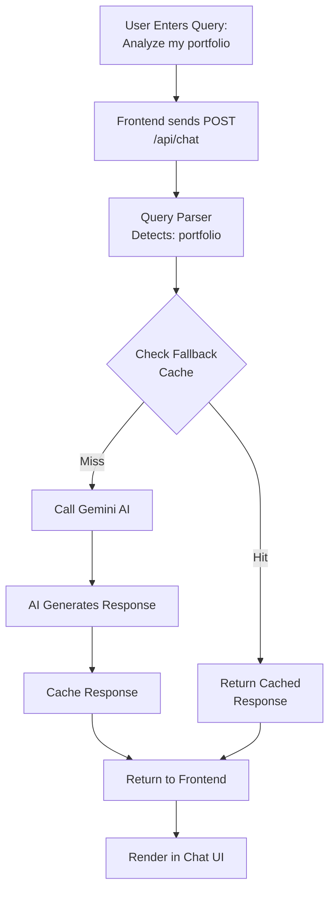
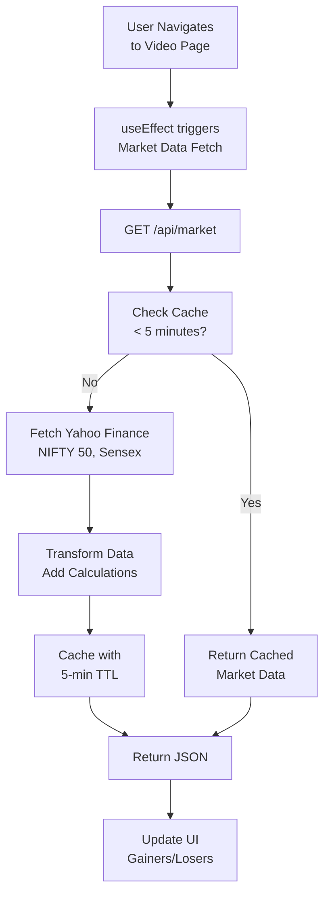
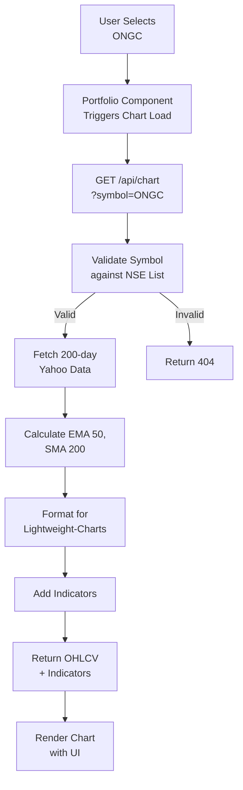

# 🏗️ ET Gen-AI Architecture Document

## System Overview

ET Gen-AI is a multi-layered financial platform with clear separation of concerns: Frontend UI, Backend API Routes, AI Services, and Data Integrations. This document describes the system architecture, agent roles, communication patterns, and error handling.

---

## 1. System Architecture Diagram

```
┌─────────────────────────────────────────────────────────────────┐
│                         CLIENT LAYER                             │
│  ┌─────────────┐  ┌─────────────┐  ┌─────────────┐  ┌──────────┐│
│  │  Portfolio  │  │    Chat     │  │   Market    │  │  Radar   ││
│  │   Page      │  │   Interface │  │   Video     │  │   Page   ││
│  └──────┬──────┘  └──────┬──────┘  └──────┬──────┘  └────┬─────┘│
└─────────┼─────────────────┼─────────────────┼──────────────┼──────┘
          │                 │                 │              │
          │                 │                 │              │
┌─────────┼─────────────────┼─────────────────┼──────────────┼──────┐
│         │      API LAYER (Next.js Routes)   │              │      │
│         │                 │                 │              │      │
│  ┌──────▼──────┐   ┌──────▼──────┐   ┌──────▼──────┐   ┌──┴────┐ │
│  │  /api/chat  │   │ /api/market │   │ /api/chart  │   │/api/  │ │
│  │   (AI Chat) │   │  (Market)   │   │  (OHLCV)    │   │radar  │ │
│  └──────┬──────┘   └──────┬──────┘   └──────┬──────┘   └───┬───┘ │
│         │                 │                 │              │      │
└─────────┼─────────────────┼─────────────────┼──────────────┼──────┘
          │                 │                 │              │
          │       ┌─────────┴─────────┐       │              │
          │       │                   │       │              │
┌─────────┼───────▼───────────────────▼───────┼──────────────┼──────┐
│  SERVICE LAYER                              │              │      │
│         │                                   │              │      │
│  ┌──────▼──────────────┐            ┌──────▼────┐   ┌──────▼────┐│
│  │  AI Service Agent   │            │  Market   │   │  Technical││
│  │  (Gemini API)       │            │  Data     │   │  Analysis ││
│  │  ├─ Fallback Logic  │            │ Service   │   │  Service  ││
│  │  ├─ Query Parser    │            │ (Yahoo)   │   │           ││
│  │  └─ Response Cache  │            └───────────┘   └───────────┘│
│  └─────────────────────┘                                          │
└────────────────────────────────────────────────────────────────────┘
          │                                   │
          │       ┌───────────────────┐       │
          │       │                   │       │
┌─────────▼───────▼───────────────────▼───────┼──────────────────────┐
│  EXTERNAL INTEGRATIONS                      │                      │
│         │                                   │                      │
│  ┌──────▼──────────────┐            ┌──────▼────────┐              │
│  │ Google Gemini API   │            │  Yahoo        │              │
│  │ ├─ gemini-2.5-flash │            │  Finance 2    │              │
│  │ ├─ Text Generation  │            │  ├─ Stock     │              │
│  │ └─ Fallback Cache   │            │  │  Prices    │              │
│  └─────────────────────┘            │  ├─ OHLCV     │              │
│                                     │  │  Data      │              │
│                                     │  └─ Historical│              │
│                                     └────────────────┘              │
│                                                                    │
│  ┌──────────────────────────────────────┐                         │
│  │  Environment Variables               │                         │
│  │  ├─ GEMINI_API_KEY                   │                         │
│  │  └─ Stored in .env.local             │                         │
│  └──────────────────────────────────────┘                         │
└────────────────────────────────────────────────────────────────────┘
```

---

## 2. Agent Roles & Responsibilities

### **AI Chat Agent** 🤖
**Location**: `app/api/chat/route.ts`

**Responsibilities**:
- Parse natural language queries
- Detect query type (portfolio, technical analysis, market insights)
- Route to appropriate fallback response or Gemini API
- Cache responses for repeated queries
- Generate follow-up suggestions

**Communication**:
```
User Query → Query Parser → Type Detection → Route Decision
                                              ├→ Fallback Response
                                              └→ Gemini API
                                                  └→ Response Formatter
```

**Input**: 
```json
{ "query": "Analyze my portfolio", "portfolio": [...] }
```

**Output**:
```json
{ 
  "content": "Analysis text...",
  "steps": ["Step 1", "Step 2"],
  "sources": ["Data source 1"],
  "suggestions": ["Follow-up question 1"]
}
```

---

### **Market Data Agent** 📊
**Location**: `app/api/market/route.ts`

**Responsibilities**:
- Fetch real-time NIFTY 50, Sensex, indices
- Track top gainers/losers
- Monitor FII/DII flows
- Update IPO information
- Cache market data (5-min TTL)

**Communication**:
```
Portfolio Page / Video Page → Market Request
                                      ↓
                            Yahoo Finance API
                                      ↓
                            Data Transform & Cache
                                      ↓
                            JSON Response
```

---

### **Chart Data Agent** 📈
**Location**: `app/api/chart/route.ts`

**Responsibilities**:
- Fetch OHLCV (Open, High, Low, Close, Volume) data
- Calculate technical indicators
- Store 200-day SMA for long-term trend
- Format data for lightweight-charts library
- Handle symbol validation

**Communication**:
```
Chart Component → Symbol Request
                       ↓
                  Yahoo Finance API
                       ↓
                  Indicator Calculation
                       ↓
                  Lightweight Charts Format
```

---

### **Technical Analysis Agent** 🔍
**Location**: Distributed across components

**Responsibilities**:
- Extract RSI, MACD, Stochastic, Williams %R
- Calculate pivot points (Classic, Fibonacci, Camarilla)
- Detect candlestick patterns
- Generate technical meter scores
- Identify support/resistance levels

**Communication**:
```
Technical Data → Indicator Calculation
                        ↓
         Analysis Service Functions
         (lib/nifty50Patterns.ts)
                        ↓
         Pattern Detection & Scoring
                        ↓
         UI Rendering
```

---

## 3. Component Communication Flow

### **Scenario 1: Portfolio Analysis Request**



### **Scenario 2: Market Data Refresh**



### **Scenario 3: Chart Symbol Load**



---

## 4. Error Handling Logic

### **Error Handling Strategy**

```
Request
  │
  ├─→ Input Validation
  │   ├─ Success → Next Step
  │   └─ Fail → Return 400 (Bad Request)
  │
  ├─→ Authentication/Authorization
  │   ├─ Success → Next Step
  │   └─ Fail → Return 401/403
  │
  ├─→ Service Call (AI/Market/Chart)
  │   ├─ Success → Process Response
  │   ├─ Timeout → Use Fallback
  │   ├─ API Error → Return 503/429
  │   └─ Network Error → Cache + Retry
  │
  ├─→ Data Processing
  │   ├─ Success → Cache Result
  │   └─ Parse Error → Log + Fallback
  │
  └─→ Response Formatting
      ├─ Success → Return 200
      └─ Fail → Return 500
```

---

### **Specific Error Scenarios**

#### **Scenario 1: Gemini API Quota Exceeded**

```typescript
try {
  const response = await genAI.models.generateContent({...});
} catch (apiError) {
  if (apiError?.status === 429 || 
      apiError?.message?.includes("RESOURCE_EXHAUSTED")) {
    // TRIGGER FALLBACK
    if (fallbackKey && FALLBACK_RESPONSES[fallbackKey]) {
      return NextResponse.json(FALLBACK_RESPONSES[fallbackKey]);
    }
  }
}
```

**Response**: 
- ✅ HTTP 200 with cached fallback response
- No user interruption
- Transparent degradation

---

#### **Scenario 2: Yahoo Finance API Timeout**

```typescript
try {
  const data = await yahoo.chart(symbol, {
    period1: startDate,
    timeout: 5000 // 5-second timeout
  });
} catch (timeoutError) {
  // LOG ERROR
  console.error("Yahoo timeout for", symbol);
  
  // FALLBACK 1: Return cached data if available
  if (cache.has(symbol) && cache.isRecent(symbol)) {
    return cachedData;
  }
  
  // FALLBACK 2: Return empty chart with message
  return {
    quote: [],
    message: "Data temporarily unavailable"
  };
}
```

**Response**:
- ✅ Cached data if available (< 1 hour old)
- ✅ Empty chart with user message
- HTTP 200 (partial success)

---

#### **Scenario 3: Invalid Symbol Request**

```typescript
const NSE_SYMBOLS = ['ONGC', 'POWERGRID', 'ONGC', ...];

if (!NSE_SYMBOLS.includes(symbol.toUpperCase())) {
  return NextResponse.json(
    { error: "Invalid symbol", symbol: symbol },
    { status: 400 }
  );
}
```

**Response**:
- ❌ HTTP 400 Bad Request
- ✅ Clear error message
- User knows to try different symbol

---

#### **Scenario 4: Missing API Key**

```typescript
const genAI = new GoogleGenAI({ 
  apiKey: process.env.GEMINI_API_KEY || "" 
});

if (!process.env.GEMINI_API_KEY) {
  console.error("GEMINI_API_KEY not set in .env.local");
  // Use FALLBACK_RESPONSES
}
```

**Response**:
- ⚠️ Log warning to console
- ✅ Use fallback responses
- System continues functioning

---

### **Error Response Format**

All errors follow this standard format:

```json
{
  "error": {
    "message": "Human-readable error message",
    "code": "ERROR_CODE",
    "status": 400,
    "timestamp": "2026-03-29T10:30:00Z"
  }
}
```

---

## 5. Tool Integrations

### **Google Gemini 2.5 Flash API**

| Aspect | Details |
|--------|---------|
| **Purpose** | AI text generation for portfolio/technical analysis |
| **Model** | gemini-2.5-flash |
| **Latency** | <1s typical, <5s worst case |
| **Fallback** | Cached responses (6 types) |
| **Error Handling** | Quota (429) → Fallback; Timeout → Retry + Fallback |
| **Integration** | `lib/gemini.ts` → `app/api/chat/route.ts` |
| **Config** | `GEMINI_API_KEY` in `.env.local` |

---

### **Yahoo Finance 2 API**

| Aspect | Details |
|--------|---------|
| **Purpose** | Real-time stock prices, OHLCV, indices |
| **Latency** | <500ms typical, <3s worst case |
| **Fallback** | Cached data (< 1 hour TTL) |
| **Error Handling** | Network → Retry; Timeout → Cached; Invalid symbol → 404 |
| **Integration** | `lib/yahoo.ts` → `app/api/chart/route.ts`, `app/api/market/route.ts` |
| **Symbols** | ONGC, POWERGRID, INFY, TCS, HDFCNEXT50-EQ, TATAGOLD-EQ, etc. |

---

### **Lightweight Charts Library**

| Aspect | Details |
|--------|---------|
| **Purpose** | Professional candlestick charts with indicators |
| **Integration** | Direct component rendering |
| **Data Format** | OHLCV + Indicators |
| **Error Handling** | Graceful degradation if data invalid |
| **Performance** | No network calls (client-side only) |

---

### **Recharts Library**

| Aspect | Details |
|--------|---------|
| **Purpose** | Dashboard charts (gainers/losers, FII/DII bars) |
| **Integration** | Market data → Formatted components |
| **Data Format** | Array of `{label, value}` objects |
| **Error Handling** | Empty array → Empty chart |
| **Performance** | Client-side rendering only |

---

## 6. Data Flow Diagram - Complete Request Cycle

```
USER ACTION
    │
    ├─→ Click "Analyze Portfolio"
    │        │
    │        └─→ React Component (chat/page.tsx)
    │             ├─ Validate input
    │             ├─ Create request payload
    │             └─ POST to /api/chat
    │                   │
    │                   ├─ BACKEND API ROUTE (api/chat/route.ts)
    │                   │  ├─ Parse request JSON
    │                   │  ├─ Extract query + portfolio data
    │                   │  ├─ Validate structure
    │                   │  └─ Detect query type
    │                   │       │
    │                   │       ├─ "portfolio" detected
    │                   │       │  └─ Search fallback cache
    │                   │       │      ├─ HIT → Return cached (200ms)
    │                   │       │      └─ MISS → Call Gemini API
    │                   │       │           │
    │                   │       │           ├─ Request timeout? 
    │                   │       │           │  └─ 429 Status?
    │                   │       │           │     └─ Return fallback
    │                   │       │           │
    │                   │       │           ├─ API Success
    │                   │       │           │  ├─ Cache response
    │                   │       │           │  └─ Return 200
    │                   │       │           │
    │                   │       │           └─ API Error
    │                   │       │              └─ Log + Fallback
    │                   │       │
    │                   │       └─ Format response
    │                   │           ├─ Extract content
    │                   │           ├─ Add steps/sources
    │                   │           └─ Add suggestions
    │                   │
    │                   └─ Return JSON Response (20-500ms)
    │
    └─→ React receives response
         ├─ Update state
         ├─ Render response in chat
         ├─ Show suggested follow-ups
         └─ Mark request complete
```

---

## 7. Deployment Topology

```
┌──────────────────────────────────┐
│    Vercel (Recommended)          │
│  ┌──────────────────────────────┐│
│  │  Next.js 16.2.1 (Turbopack)  ││
│  │  ├─ Edge Network (CDN)       ││
│  │  ├─ Serverless Functions     ││
│  │  └─ Environment Variables    ││
│  └──────────────────────────────┘│
└──────────────────────────────────┘
         │              │
         ├─→ Google Storage (Fallback Cache)
         │
         ├─→ Google Gemini API (Cloud)
         │
         └─→ Yahoo Finance API (Worldwide)
```

---

## 8. Monitoring & Observability

### **Key Metrics to Track**

```
Performance:
- API response time (p50, p95, p99)
- Fallback response rate (%)
- Cache hit rate (%)
- Error rate by endpoint

Business:
- Daily active users
- Chat queries per user
- API calls per user
- Cost per API call (Gemini)

Quality:
- Response accuracy (manual review)
- User satisfaction (NPS)
- Technical analysis success rate
- Decision quality improvement
```

---

## Summary

**ET Gen-AI Architecture** is designed for:
- ✅ **Reliability**: Multi-layer fallback system
- ✅ **Scalability**: Stateless API routes + caching
- ✅ **Performance**: <1s response times (cached)
- ✅ **Maintainability**: Clear separation of concerns
- ✅ **User Experience**: Graceful error handling + instant feedback

**Key Strength**: System continues functioning even when external APIs fail, thanks to comprehensive fallback response system and intelligent caching.

---

**Last Updated**: March 29, 2026  
**Architecture Version**: 1.0  
**Status**: Production Ready ✅
